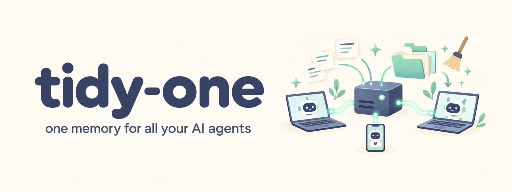
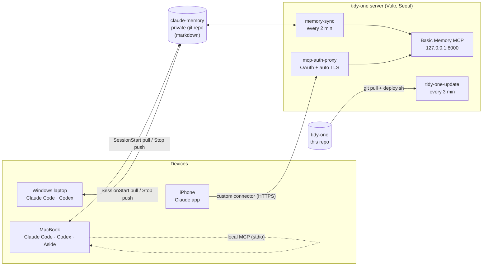

<p align="center">
  
</p>

<p align="center">
  <a href="LICENSE"></a>
  
  
  
  
</p>

<p align="center">
  <b>One tidy, private memory that every AI agent you use can read — on every device you own.</b><br>
  Claude Code · Codex · Aside · claude.ai (web &amp; iOS) — same notes, same search, one small server.
</p>

---

## Why

Every agent keeps its own little memory. Claude Code remembers per folder, Aside has its own notes, the phone app knows nothing about your laptop. **tidy-one** gives them one place to look:

- **Plain markdown is the source of truth.** Memories live in a private git repo you can read, edit and diff. No lock-in, no opaque database.
- **Semantic search in Korean and English.** Local multilingual embeddings + full-text search via [Basic Memory](https://github.com/basicmachines-co/basic-memory).
- **Every client, one endpoint.** Local MCP for Claude Code and Codex; a password-protected HTTPS MCP connector for claude.ai web and mobile.
- **Fits a $10 VPS.** 1 vCPU / 2 GB is enough; embeddings run on-device where it matters.
- **Push to deploy.** The server pulls this repo and redeploys itself. No CI secrets, no inbound SSH from GitHub.

## How it fits together



| Piece | What it does |
|---|---|
| `claude-memory` repo | Markdown memories with frontmatter. Claude Code's `autoMemoryDirectory` points at it on every device. |
| Basic Memory | Indexes the repo (SQLite FTS + sqlite-vec, `paraphrase-multilingual-MiniLM-L12-v2`) and serves MCP tools like `search_notes`. Configured never to rewrite your files. |
| `memory-sync` | Keeps the server's copy in step with GitHub, and pushes edits made through the server. |
| `mcp-auth-proxy` | Public HTTPS + OAuth login in front of Basic Memory, so claude.ai can connect. Off until you turn it on. |
| `tidy-one-update` | Pull-based auto-deploy of this repo. |

## Quick start

### 1. Server (fresh Ubuntu 24.04)

```bash
scp server/bootstrap.sh root@<server-ip>:
ssh root@<server-ip> sh bootstrap.sh
```

`bootstrap.sh` installs git, uv, Basic Memory, a firewall (22/80/443) and swap, creates a `memory` user, and prints two deploy keys. Add them on GitHub (memory repo: read-write, this repo: read-only), run it again, and it clones both repos and deploys.

### 2. Your devices

```bash
git clone git@github.com:<you>/claude-memory.git ~/claude-memory
```

Merge [`client/macos/claude-settings.example.json`](client/macos/claude-settings.example.json) into `~/.claude/settings.json`, then register the local MCP server:

```bash
uv tool install basic-memory
bm project add claude-memory ~/claude-memory --default
```

### 3. Phone and web (optional)

```bash
sh server/enable-connector.sh <server-ip>
```

This creates a password on your Mac only, sends its bcrypt hash to the server and starts the HTTPS connector at `https://<ip-with-dashes>.sslip.io/mcp`. Add that URL in claude.ai → Settings → Connectors.

## Deploying changes

Push to `main`. Within ~3 minutes the server's `tidy-one-update.timer` notices, resets `/opt/tidy-one` to `origin/main` and runs [`server/deploy.sh`](server/deploy.sh), which only restarts what changed.

```bash
ssh root@<server-ip> /opt/tidy-one/server/update.sh --force   # deploy right now
ssh root@<server-ip> journalctl -u tidy-one-update -n 20       # what happened
```

## Repository layout

```
server/
  bootstrap.sh          one-time VPS setup
  deploy.sh             idempotent deploy (units, Basic Memory config, restarts)
  update.sh             pull-based auto-deploy, run by tidy-one-update.timer
  enable-connector.sh   owner-only: turn on the public connector
  bin/memory-sync.sh    git pull/commit/push for the memory repo
  systemd/              basic-memory, memory-sync, memory-proxy, tidy-one-update
client/macos/           settings example, Aside memory mirror
docs/research/          design research (Korean): architecture, engines, devices, OSS survey
```

## Roadmap

Based on the [design research](docs/research/개인%20기기%20통합%20인덱싱%20설계.md):

- [x] Shared markdown memory across devices (git + Claude Code auto memory)
- [x] Semantic search on Mac and server (Basic Memory, multilingual embeddings)
- [x] Push-to-deploy server
- [ ] Public connector for claude.ai web and iOS, verified against the OAuth requirements
- [ ] Korean-tuned embeddings (bge-m3 / KURE) and Kiwi morpheme search
- [ ] Device agents for Mac and Windows: index file metadata + excerpts, originals stay on device (Tailscale fetch)
- [ ] iPhone inputs via Shortcuts / Working Copy

## Security notes

- Secrets never live in this repo. The connector password stays on your Mac; the server only stores its bcrypt hash in `/etc/tidy-one/proxy.env` (root-only).
- Basic Memory listens on `127.0.0.1` only. The proxy is the single public entry point and is off by default.
- An index that can read all your notes is also a way out for them. Keep the connector password strong and treat tool output from untrusted pages with care.

## License

[MIT](LICENSE)
